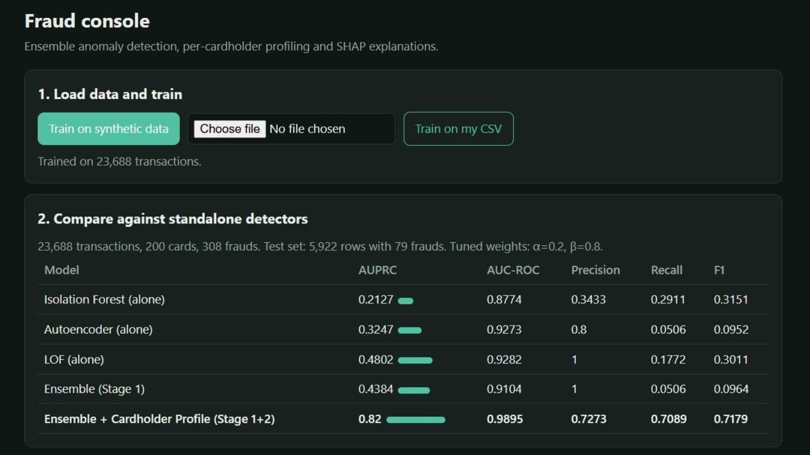

# 🛡️ Fraud Guard
### Adaptive Hybrid Ensemble Anomaly Detection for Credit Card Fraud

A machine-learning project combining anomaly detection, cardholder profiling, explainable risk scoring and concept-drift experiments.

**Technologies:** Python · FastAPI · Scikit-learn · NumPy · Pandas · SHAP

---

## 👀 Project Overview

Fraud Guard analyses transaction patterns to identify potentially suspicious activity. It combines multiple anomaly detectors with individual cardholder behaviour to produce a final risk score.



## ✨ Key Features

- **Hybrid Ensemble Detection:** Isolation Forest, Autoencoder and Local Outlier Factor.
- **Cardholder Profiling:** Learns individual spending behaviour.
- **Transaction Risk Scoring:** Combines ensemble and personal-profile scores.
- **Explainable Predictions:** Displays feature contributions behind suspicious transactions.
- **Model Evaluation:** Compares AUPRC, AUC-ROC, precision, recall and F1.
- **Concept Drift:** Compares static models with sliding-window retraining.
- **CSV Upload:** Supports custom transaction datasets.

## 🖥️ Application Screenshots

### 1. Model Training and Comparison


### 2. Flagged Transactions


### 3. Transaction Risk Explanation


### 4. Concept Drift Experiment


## 🧠 Detection Workflow

```text
Transaction Data
       |
       v
Data Preparation
       |
       v
Stage 1: Ensemble Detection
  |        |          |
Isolation  Autoencoder  LOF
  |        |          |
       v
Stage 2: Cardholder Profile
       |
       v
Combined Risk Score
       |
       v
Suspicious Transaction?
       |
       v
SHAP Explanation
```

Final score:

`Final = α × Ensemble + β × Personal`

The weights are tuned using validation data.

## 📊 Model Performance

Results from the experiment displayed in the application:

| Model | AUPRC | AUC-ROC | Precision | Recall | F1 |
|---|---:|---:|---:|---:|---:|
| Isolation Forest | 0.2127 | 0.8774 | 0.3433 | 0.2911 | 0.3151 |
| Autoencoder | 0.3247 | 0.9273 | 0.8000 | 0.0506 | 0.0952 |
| LOF | 0.4802 | 0.9282 | 1.0000 | 0.1772 | 0.3011 |
| Ensemble Stage 1 | 0.4384 | 0.9104 | 1.0000 | 0.0506 | 0.0964 |
| **Ensemble + Profile** | **0.8200** | **0.9895** | **0.7273** | **0.7089** | **0.7179** |

*These are experiment-specific results, not guaranteed real-world performance.*

## ⚙️ Installation

### Requirements
- Python 3.10+
- pip

### 1. Clone the repository

```bash
git clone https://github.com/rrandomdev2023/fraud-guard.git
cd fraud-guard
```

### 2. Create a virtual environment

```powershell
cd backend
python -m venv venv
venv\Scripts\activate
```

### 3. Install dependencies

```bash
pip install -r requirements.txt
```

### 4. Run the application

```bash
uvicorn app.main:app --reload
```

Open:

- Dashboard: http://127.0.0.1:8000
- API documentation: http://127.0.0.1:8000/docs

Select **Train on synthetic data** to start the training workflow.

## 📁 Dataset Format

CSV input requires:

| Column | Description |
|---|---|
| `card_id` | Cardholder identifier |
| `timestamp` | Transaction date and time |
| `amount` | Transaction amount |
| `merchant_category` | Merchant category |
| `distance_km` | Distance from home |
| `is_fraud` | Fraud label |

## 🔬 Implementation Notes

- Autoencoder uses Scikit-learn `MLPRegressor` with an 8-3-8 bottleneck.
- Detector fitting uses normal, earlier transactions.
- Evaluation uses the latest 25% of the timeline.
- Threshold selection is performed on validation data.
- Concept drift experiments compare static and sliding-window approaches.

## 🧰 Technology Stack

Python · FastAPI · Scikit-learn · NumPy · Pandas · SHAP · HTML · CSS · JavaScript

## 👥 Team

An academic MCA project developed collaboratively. Contributions and improvements are welcome through GitHub issues and pull requests.

## ⚠️ Disclaimer

Fraud Guard is an academic demonstration and research project. Its predictions are experimental and should not be used as the sole basis for real financial decisions.

---

<div align="center">

**⭐ If you find this project interesting, consider starring the repository!**

</div>
