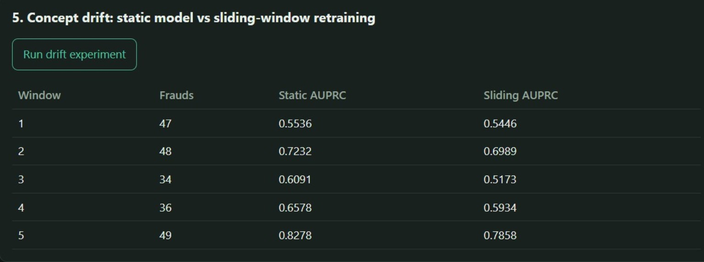

<!-- Animated Fraud Guard banner -->

  

<!-- Add the screenshot section wherever it fits in your README -->
## Application Screenshots

### Dashboard and model comparison

### Flagged transactions

### Transaction risk scoring and explanation

### Concept drift experiment

