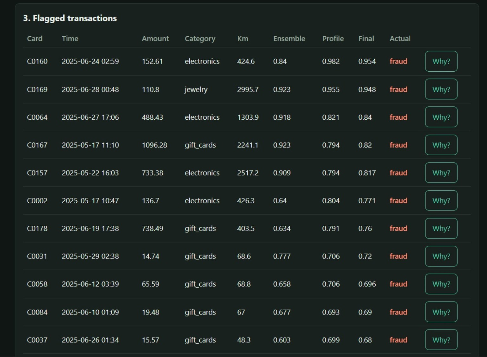
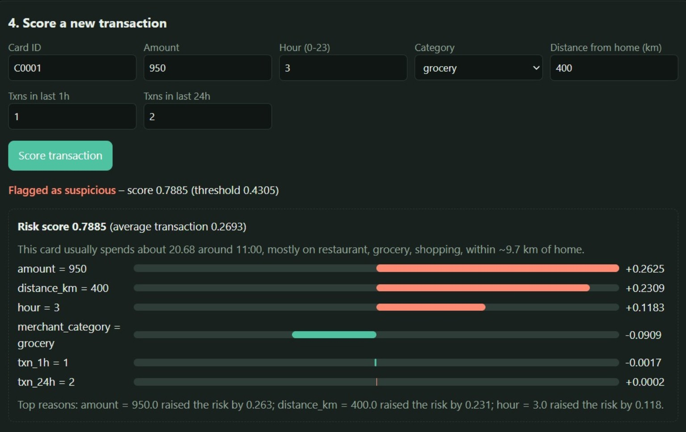

<div align="center">

# 🛡️ FRAUD GUARD

### Adaptive Hybrid Ensemble Anomaly Detection for Credit Card Fraud

**Intelligent Transaction Monitoring · Explainable AI · Fraud Risk Scoring**

<p align="center">
  
</p>
<br>


</div>

---

## 👀 Project Overview

Fraud Guard is a machine-learning-based credit card fraud detection system that analyses transaction patterns to identify potentially suspicious activity.

It combines multiple anomaly detection algorithms with individual cardholder behaviour profiling to generate transaction risk scores and provide explainable predictions.

### 🎬 Live Project Demonstration

Explore Fraud Guard in action. Watch the demonstration to see the dashboard, transaction analysis, fraud detection workflow and model results.

<div align="center">

<a href="https://www.youtube.com/watch?v=_WJSLMlAaA8">
  
</a>

**▶️ [Watch the Full Project Demonstration on YouTube](https://www.youtube.com/watch?v=_WJSLMlAaA8)**

</div>

---

## ✨ Key Features

| Feature | Description |
|---|---|
| 🧠 Hybrid Ensemble Detection | Combines Isolation Forest, Autoencoder and Local Outlier Factor. |
| 👤 Cardholder Profiling | Learns individual spending behaviour. |
| 📊 Transaction Risk Scoring | Combines ensemble and personal-profile scores. |
| 🔍 Explainable Predictions | Displays feature contributions behind suspicious transactions. |
| 📈 Model Evaluation | Compares AUPRC, AUC-ROC, precision, recall and F1. |
| 🔄 Concept Drift | Compares static models with sliding-window retraining. |
| 📁 CSV Upload | Supports custom transaction datasets. |

---

## 🖥️ Application Screenshots

### 1. Dashboard and Model Comparison

View model training status, dataset statistics and performance comparisons.

<p align="center">
  
</p>

### 2. Flagged Transactions

Review potentially suspicious transactions and their corresponding risk scores.

<p align="center">
  
</p>

### 3. Transaction Risk Explanation

Analyse transaction risk scores and the factors contributing to suspicious predictions.

<p align="center">
  
</p>

### 4. Concept Drift Experiment

Compare static model performance with sliding-window retraining.

<p align="center">
  
</p>

---

## 🧠 Detection Workflow

Fraud Guard follows a two-stage detection approach.

```text
                 TRANSACTION DATA
                         |
                         v
               DATA PREPARATION
                         |
                         v
            STAGE 1: ENSEMBLE DETECTION
                         |
             +-----------+-----------+
             |           |           |
             v           v           v
         Isolation   Autoencoder    LOF
          Forest
             |           |           |
             +-----------+-----------+
                         |
                         v
            STAGE 2: CARDHOLDER PROFILE
                         |
                         v
                COMBINED RISK SCORE
                         |
                         v
              SUSPICIOUS TRANSACTION?
                         |
                         v
                  SHAP EXPLANATION
```

### Risk Score Calculation

The final score combines the ensemble signal and the personal-profile signal:

`Final Score = α × Ensemble Score + β × Personal Score`

The weights are tuned using validation data.

---

## 📊 Model Performance

Results from the experiment displayed in the application:

| Model | AUPRC | AUC-ROC | Precision | Recall | F1 |
|---|---:|---:|---:|---:|---:|
| Isolation Forest | 0.2127 | 0.8774 | 0.3433 | 0.2911 | 0.3151 |
| Autoencoder | 0.3247 | 0.9273 | 0.8000 | 0.0506 | 0.0952 |
| LOF | 0.4802 | 0.9282 | 1.0000 | 0.1772 | 0.3011 |
| Ensemble Stage 1 | 0.4384 | 0.9104 | 1.0000 | 0.0506 | 0.0964 |
| **Ensemble + Profile** | **0.8200** | **0.9895** | **0.7273** | **0.7089** | **0.7179** |

*These are experiment-specific results, not guaranteed real-world performance.*

---

## ⚙️ Installation and Setup

### Requirements

- Python 3.10+
- pip
- Git

### 1. Clone the Repository

```bash
git clone https://github.com/rrandomdev2023/fraud-guard.git
cd fraud-guard
```

### 2. Create a Virtual Environment

**Windows PowerShell**

```powershell
cd backend
python -m venv venv
venv\Scripts\Activate.ps1
```

**Linux / macOS**

```bash
cd backend
python3 -m venv venv
source venv/bin/activate
```

### 3. Install Dependencies

```bash
pip install -r requirements.txt
```

### 4. Run the Application

```bash
uvicorn app.main:app --reload
```

### 5. Open the Application

| Service | URL |
|---|---|
| Fraud Guard Dashboard | http://127.0.0.1:8000 |
| Interactive API Documentation | http://127.0.0.1:8000/docs |

Select **Train on synthetic data** to start the built-in training workflow.

---

## 📁 Dataset Format

CSV input requires the following columns:

| Column | Description |
|---|---|
| `card_id` | Cardholder identifier |
| `timestamp` | Transaction date and time |
| `amount` | Transaction amount |
| `merchant_category` | Merchant category |
| `distance_km` | Distance from home |
| `is_fraud` | Fraud label |

---

## 🔬 Implementation Notes

- The Autoencoder uses Scikit-learn `MLPRegressor` with an 8-3-8 bottleneck.
- Detector fitting uses normal, earlier transactions.
- Evaluation uses the latest 25% of the timeline.
- Threshold selection is performed on validation data.
- Concept drift experiments compare static and sliding-window approaches.

---

## 🧰 Technology Stack

<div align="center">


</div>

**Additional tools:** SHAP · HTML · CSS

---

## 👥 Team

## 👥 Project Team

Fraud Guard was developed as a collaborative MCA academic project, bringing together concepts from machine learning, artificial intelligence, data analytics and web development.

### Team Members

| Sl. No. | Name |
|---|---|
| 1 | Dipika Goswami |
| 2 | Bhagirath Shaw |
| 3 | Komal Singh |
| 4 | Aman Prasad |
| 5 | Aniket Kumar Singh |

### Project Details

- **Project Title:** Fraud Guard
- **Project Domain:** Machine Learning and Cybersecurity
- **Programme:** Master of Computer Applications (MCA)
- **Institution:** Adamas University

### Areas of Contribution

The project involved collaborative work in:

- Machine Learning and anomaly detection
- Backend development and API integration
- Frontend design and dashboard development
- Data preprocessing and model evaluation
- Testing, documentation and project presentation

---

## ⚠️ Disclaimer

Fraud Guard is an academic demonstration and research project.

Its predictions and risk scores are experimental and should not be used as the sole basis for real financial decisions. Real-world deployment requires additional validation, testing and security controls.

---

<div align="center">

### ⭐ Support the Project

If you find Fraud Guard interesting, consider giving this repository a star!

**Built with ❤️ for learning, experimentation and safer digital transactions.**

[GitHub Repository](https://github.com/rrandomdev2023/fraud-guard) · [Project Demo](https://www.youtube.com/watch?v=_WJSLMlAaA8) · [Report an Issue](https://github.com/rrandomdev2023/fraud-guard/issues)

</div>
